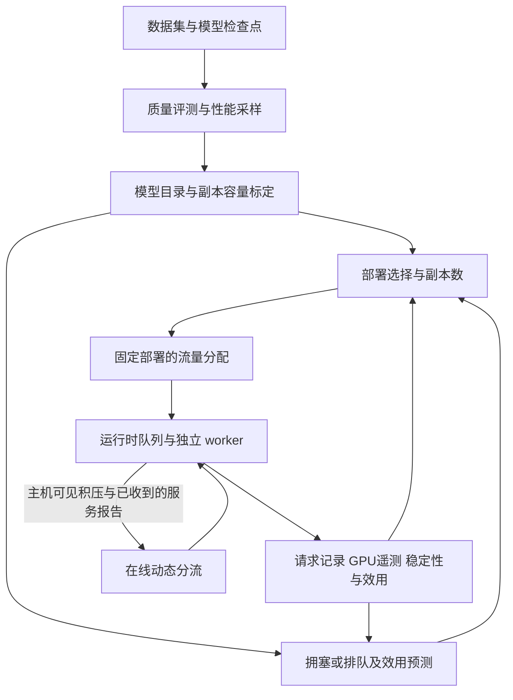

# 算法代码架构

## 决策变量与整体流程

项目研究六类任务：`text`、`image`、`ocr`、`asr`、`visual_qa`、`lid`。主要决策变量是部署副本数 `x[m]` 与任务到模型的流量 `r[k,m]`（req/s），输入包括负载 `lambda[k]`、模型能力/质量准入、服务时间、显存与副本容量证据。



部署优化、流量优化、逐请求在线分流是不同的决策层。它们共享部分数据与测量底座，但没有统一成一个正式算法入口。

## 基础求解与搜索

`deployment_core` 定义 `ModelProfile`、`Hardware`、`Workload` 与部署/路由 witness。MILP 初始化检查能力覆盖、流量守恒、部署关联、显存预算与容量约束，产生最小显存可行 seed。

整数副本规划支持线性容量和经验容量两种模式；经验分支使用离散容量 `g_m(n)` 与显存 `M_m(n)` 表，并受已测副本数和实际 worker 上限限制。单模型测得的容量因子仍是规划输入，不能直接当作任意共驻留部署的实测容量。

`deployment_search` 从 seed 开始，以 canonical min-max LP 分配流量、提取瓶颈、生成一跳邻域，再选择 Top-B 进行运行时评价。`method_v1` 包装冻结的原实现；`method_v2` 增加针对性替换及类别多样化选择。冻结 MethodV2 要求 `predictor=None`，不能在整理时直接注入后期预测器。

`module9bc/frozen_v3.py` 保留后续 V3 身份。V3 使用 J 路由/排序，部署接受仍沿用原噪声敏感性能判据；这不等于全局只优化 J。Module33/34 的摘要区分原生连续实现与有限网格控制实验。

## 拥塞目标 J

`deployment_core/routing/e2e_surrogate.py` 定义：

```text
D_m = sum_k r_km * s0_km
rho_m = D_m / g_m(x_m)
J = sum_m D_m / (1 - rho_m) / sum_k lambda_k
```

服务时间先转换成秒。`e2e_router.py` 固定部署，以 SLSQP 优化连续路由，再通过线性子问题验证凸目标的最优性差距。

`module11b/12` 扩展离散部署求解与数值切平面复用；`module15/16` 包含先最小实测显存、再比较 J 的资源策略与数值增强。Module12 通过 AST 改写复用早期函数，说明求解器与实验仍有较强耦合。

## 综合效用 U 与预测

`module20/optimizer.py::components` 提供共享归一化与加权计算。当前质量以准入/能力约束控制，`Q_contribution=0`；U 汇总吞吐损失、任务均值/P95 和显存成本。任务加权 P95 与全系统 pooled P95 不是同一个指标。

各条预测/优化路线分别为：

| 实现 | 方法与用途 |
| --- | --- |
| `performance_model/` | 早期预测接口、特征和分段基线；采样、泛化及校准子实验 |
| `module20/` | 线性 MILP 有限候选生成；周期到达、FIFO 模拟及 U 排序 |
| `module21/` | Poisson 到达，排队等待分布的 FFT 数值计算与连续分流优化 |
| `module25/` | 路由条件下的服务均值/分位数形状/传输预测，再计算排队与 U；通过预测 gate 才可优化 |
| `results/module33_mixed_oracle/` | 有限 Mixed Oracle 空间与原有算法比较 |
| `results/module34_candidate_pool/` | 嵌套候选池扩展、目标误差与搜索误差分析 |
| `results/module35_utility_routing/` | 独立 U 对齐优化，复用原 Module20 FIFO predictor |

Module35 的 K=1 算法将模型与任务子集组成 bundle，缓存局部预测，并用显存/成本/窗口内完成数进行 Pareto 动态规划。K>1 要求固定合法部署，并进行有界离散路由搜索。有限域 CPU 正确性、holdout 与 GPU 对比证据分别记录在其 Gate 与摘要中；部分 GPU 微差仍不确定，历史预测器不足 Gate 保留。

## 在线策略

Module28/29 的 `DynamicRouter` 根据主机可见待处理请求和已收到的服务报告估计成本，使用 EWMA、滞回、令牌限流、在途上限、冷却及预测误差回退。

Module32B 及其后续目录包含 VQA 感知策略：保护共享通用 worker 上的视觉问答，结合 ASR 输入时长成本、专用模型压力、风险预算与分流份额限制决定是否接纳。相关工程修复和独立效用验证有不同 Gate；不能用一次探索结果替代独立验证。

这些源码位于 `results/`，部分目录还有自己的 `m32*`、`m33`、`m34`、`m35` 包。实验索引必须同时扫描根目录和结果目录。

## 执行与评估

`joint_deploy/worker_protocol.py` 使用 stdin/stdout JSON 消息；worker 发出 `READY / RESULT / ERROR / BYE`。注册表为不同模型指定独立 Python 环境和启动脚本。

`joint_deploy/measurement/` 负责负载生成、路由、主机发送队列、进程生命周期、时间戳收集、预热与排空。基础 `DeploymentRuntime` 每个 transport ID 只支持一个实例；多副本实验使用 `model#0`、`model#1` 等 ID 启动独立进程。基础配置仅支持周期到达，Poisson/冻结轨迹由后续实验适配。

测量区分 E2E、提交后耗时、worker handler 耗时、主机调度延迟与 worker 排队等待，并记录窗口内完成、排空完成、失败及未完成。`performance_model/local_calibration/stability_v2.py` 从请求记录重建积压和服务债务。

后期实验额外复用进程遥测、持久化 journal、缓存隔离和控制线程检查。Module31A 通过覆盖旧模块全局输出变量复用框架；Module32 系列继续实现基础设施修复。这些能力应在后续逐步抽取为稳定运行时接口。

## 后续整理的依赖方向

目标是 `experiment -> public library -> domain/config`，公共库不导入编号实验模块。第一轮仅添加导航与清单；后续逐项抽取指标/效用、运行时、模型目录、求解器与预测器。每项迁移应有现有记录回放和相同输入对照，历史冻结实现继续保留。
